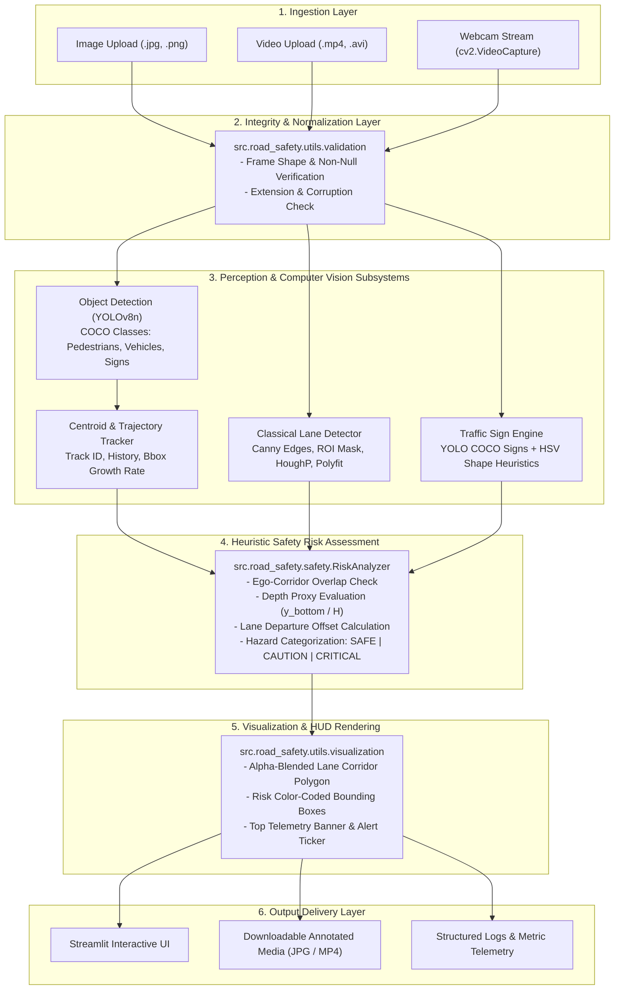

# Architecture Specification: AI-Road-Safety System

**OpenCV AI Competition 2026 powered by AWS**  
*Project: AI-Powered Road Safety and Pedestrian Detection System*

---

## 1. System Overview

The **AI-Road-Safety System** is an end-to-end computer vision and situational awareness pipeline designed to assist drivers and analyze road footage. It operates across three distinct input modalities: static dashcam images, recorded driving video clips, and live camera streams.

The core design philosophy is **safety through explainability**: instead of treating driver assistance as an opaque black box, every warning is tied to observable geometric visual evidence—detected obstacle boundaries, fitted lane corridors, and relative horizon proximities.

---

## 2. End-to-End Data Flow Diagram

---

## 3. Subsystem Breakdown

### 3.1 Input Validation (`src/road_safety/utils/validation.py`)
- Verifies input frames are valid 2D/3D uint8 numpy arrays with dimensions >= 10x10.
- Rejects zero-byte or unreadable files before passing data to heavy neural network models.
- Returns structured `(is_valid, error_msg)` tuples to prevent unhandled pipeline exceptions.

### 3.2 Object Detection (`src/road_safety/detection/detector.py`)
- Employs **Ultralytics YOLO** (defaulting to `yolov8n.pt` for real-time CPU feasibility).
- Filters incoming detections to road-critical COCO classes:
  - `0`: Person (Pedestrian)
  - `1`: Bicycle (Cyclist)
  - `2`: Car
  - `3`: Motorcycle
  - `5`: Bus
  - `7`: Truck
  - `9`: Traffic Light
  - `11`: Stop Sign
- Produces `DetectionResult` dataclasses featuring bounding coordinates, ground contact bottom-center coordinates `((x1+x2)//2, y2)`, and vertical perspective depth proxy `y2 / height`.

### 3.3 Multi-Object Tracking (`src/road_safety/detection/tracker.py`)
- Implements a distance-matrix centroid tracker with bounding box area expansion monitoring.
- Tracks persist across frames with unique integer IDs.
- Calculates bounding box growth rate ($\text{area}_{t} / \text{area}_{t-1}$) as a 2D optical proxy for approaching speed.
- Objects unobserved for more than `tracker_max_age` (default 15 frames) are safely deregistered.

### 3.4 Classical Lane Detection (`src/road_safety/lanes/lane_detector.py`)
- **Stage 1: Grayscale & Blur**: Converts BGR frame to single-channel luminance; applies Gaussian smoothing ($k=5$).
- **Stage 2: Canny Edge Detection**: Dynamically thresholds gradients (defaults: low=50, high=150).
- **Stage 3: Trapezoidal ROI Mask**: Restricts search to the lower triangular road corridor, eliminating trees, sky, and signs.
- **Stage 4: Probabilistic Hough Transform (`HoughLinesP`)**: Identifies candidate line segments.
- **Stage 5: Slope Separation & Fitting**:
  - Left lane candidates: negative slope ($\Delta y / \Delta x \in [-2.5, -0.35]$) on left half of scene.
  - Right lane candidates: positive slope ($\Delta y / \Delta x \in [0.35, 2.5]$) on right half of scene.
  - Fits boundary polynomials $x = m \cdot y + c$ using length-weighted linear regression. Expressing $x$ as a function of $y$ avoids division-by-zero singularities on vertical lane lines.
- **Stage 6: Temporal Exponential Moving Average (EMA)**:
  - $x_{\text{smoothed}} = \alpha \cdot x_{\text{prev}} + (1 - \alpha) \cdot x_{\text{curr}}$ (with $\alpha = 0.70$) prevents jitter between video frames.
- **Stage 7: Lane Departure Warning (LDW)**:
  - Assumes vehicle camera center is at image bottom-center ($W/2$).
  - Calculates lane center at bottom edge: $(x_{\text{left}} + x_{\text{right}}) / 2$.
  - Triggers LDW when deviation exceeds configurable threshold (default 50px).

### 3.5 Traffic Sign Engine (`src/road_safety/signs/sign_detector.py`)
- Integrates native YOLO COCO detections for Stop Signs and Traffic Signals.
- Includes a HSV color-thresholding and polygonal contour approximation engine to identify candidate triangular (yield/warning), octagonal (stop), and circular (regulatory) signs.
- Provides an extensible architectural hook for dedicated GTSRB (German Traffic Sign Recognition Benchmark) classification models.

### 3.6 Safety Risk Analyzer (`src/road_safety/safety/risk_analyzer.py`)
- Evaluates spatial proximity and trajectory intersection without claiming certified physical distance.
- Defines a central forward **Ego-Corridor** ($36\%$ of image width).
- **Hazard Classification**:
  - `CRITICAL_WARNING` (Red): Vulnerable road user (pedestrian/cyclist) directly inside forward ego corridor with high depth proxy ($\ge 0.70$), or vehicle with imminent proximity ($\ge 0.78$).
  - `CAUTION` (Amber): Pedestrian near roadway ($\ge 0.50$), forward vehicle decelerating, lane departure deviation, or stop sign detected ahead.
  - `SAFE` (Green): Forward path clear, lane keeping maintained.

### 3.7 Visualizer & HUD (`src/road_safety/utils/visualization.py`)
- Renders a semi-transparent, alpha-blended green corridor polygon inside the detected lane boundaries.
- Color-codes object bounding boxes according to individual threat severity.
- Renders an automotive-inspired top telemetry bar displaying real-time FPS, inference latency, hardware target, lane status, and active hazard alerts.

---

## 4. Hardware Optimization & Cloud Readiness

- **CPU Optimization**: Safe auto-detection of CUDA with automatic fallback to CPU. Frame-stride skipping enables 30 FPS playback simulation on standard dual-core laptops.
- **Cloud Decoupling**: Application core has zero hard dependencies on AWS credentials, allowing offline evaluation. Containerized via standard Dockerfile and ECS/Fargate deployment blueprints.
