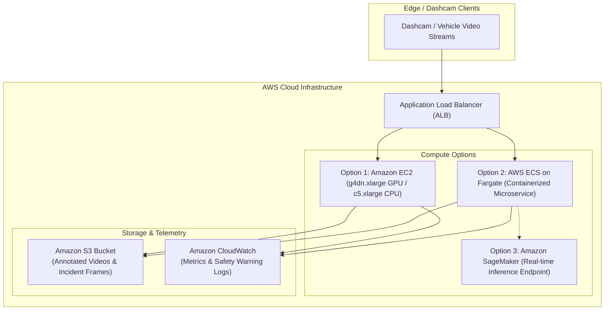

# AWS Cloud Deployment Architecture & Runbook

**OpenCV AI Competition 2026 powered by AWS**  
*Project: AI-Powered Road Safety and Pedestrian Detection System*

---

> [!IMPORTANT]
> **No AWS Credentials Required for Local Use**:
> Running the application locally or testing it requires zero cloud credentials and zero internet access once packages and sample assets are present. This guide serves as a cloud migration path for competition evaluation, cloud hosting, and fleet telemetry ingestion.

---

## 1. Cloud Architecture Overview

The system offers three scalable AWS deployment patterns tailored for different operational scenarios:



---

## 2. Option 1: Standalone Amazon EC2 Deployment

Best for: Rapid demonstration, hackathons, and GPU-accelerated video batch processing.

### Recommended Instance Types
- **GPU Accelerated**: `g4dn.xlarge` (1 NVIDIA T4 GPU, 4 vCPUs, 16 GB RAM) - optimal for high-throughput 60+ FPS multi-stream analysis.
- **CPU Optimized**: `c5.xlarge` (4 vCPUs, 8 GB RAM) - budget-conscious, handles 15–25 FPS with YOLOv8 nano.

### Step-by-Step Deployment on Amazon Linux 2023 or Ubuntu 22.04 LTS

1. **Launch Instance**:
   - AMI: Ubuntu Server 22.04 LTS (HVM) or Deep Learning AMI (Ubuntu 22.04).
   - Security Group: Allow Inbound TCP port `22` (SSH) and TCP port `8501` (Streamlit).

2. **Connect and Install Dependencies**:
   ```bash
   ssh -i your-key.pem ubuntu@<ec2-public-ip>

   # Update system and install Python 3.11 & FFmpeg
   sudo apt-get update && sudo apt-get install -y \
       python3.11 python3.11-venv python3-pip \
       ffmpeg libgl1 libglib2.0-0 git

   # Clone your repository
   git clone https://github.com/your-org/AI-Road-Safety.git
   cd AI-Road-Safety

   # Setup virtual environment
   python3.11 -m venv venv
   source venv/bin/activate
   pip install --upgrade pip
   pip install -r requirements.txt
   ```

3. **Generate Sample Assets & Run Tests**:
   ```bash
   python scripts/generate_samples.py
   pytest tests/
   ```

4. **Run Streamlit as a Background Systemd Service**:
   Create `/etc/systemd/system/roadsafety.service`:
   ```ini
   [Unit]
   Description=AI Road Safety Streamlit Service
   After=network.target

   [Service]
   User=ubuntu
   WorkingDirectory=/home/ubuntu/AI-Road-Safety
   ExecStart=/home/ubuntu/AI-Road-Safety/venv/bin/streamlit run app.py --server.port=8501 --server.address=0.0.0.0
   Restart=always

   [Install]
   WantedBy=multi-user.target
   ```
   Start the service:
   ```bash
   sudo systemctl daemon-reload
   sudo systemctl enable --now roadsafety
   ```
   Access at: `http://<ec2-public-ip>:8501`

---

## 3. Option 2: AWS ECS (Elastic Container Service) on Fargate

Best for: Production multi-tenant deployments with automated scaling and zero server maintenance.

### Build and Push Container to Amazon ECR

1. **Authenticate Docker with Amazon ECR**:
   ```bash
   aws ecr get-login-password --region us-east-1 | docker login --username AWS --password-stdin <aws_account_id>.dkr.ecr.us-east-1.amazonaws.com
   ```

2. **Create ECR Repository**:
   ```bash
   aws ecr create-repository --repository-name ai-road-safety-app --region us-east-1
   ```

3. **Build and Tag Docker Image**:
   ```bash
   docker build -t ai-road-safety-app .
   docker tag ai-road-safety-app:latest <aws_account_id>.dkr.ecr.us-east-1.amazonaws.com/ai-road-safety-app:latest
   ```

4. **Push Image**:
   ```bash
   docker push <aws_account_id>.dkr.ecr.us-east-1.amazonaws.com/ai-road-safety-app:latest
   ```

5. **ECS Task Definition Blueprint**:
   ```json
   {
     "family": "road-safety-task",
     "networkMode": "awsvpc",
     "requiresCompatibilities": ["FARGATE"],
     "cpu": "2048",
     "memory": "4096",
     "containerDefinitions": [
       {
         "name": "road-safety-container",
         "image": "<aws_account_id>.dkr.ecr.us-east-1.amazonaws.com/ai-road-safety-app:latest",
         "portMappings": [
           {
             "containerPort": 8501,
             "protocol": "tcp"
           }
         ],
         "logConfiguration": {
           "logDriver": "awslogs",
           "options": {
             "awslogs-group": "/ecs/road-safety",
             "awslogs-region": "us-east-1",
             "awslogs-stream-prefix": "ecs"
           }
         }
       }
     ]
   }
   ```

---

## 4. Option 3: Incident Telemetry Archiving with Amazon S3

For fleet management, near-miss events (such as `CRITICAL_WARNING: PEDESTRIAN IN FORWARD PATH`) can be automatically exported to Amazon S3.

### Integration Blueprint (`src/road_safety/cloud/s3_exporter.py` pattern)

```python
import boto3
from pathlib import Path

def export_hazard_event_to_s3(
    image_path: Path,
    metadata: dict,
    bucket_name: str,
    s3_prefix: str = "hazards/",
):
    """Asynchronously export critical hazard frame and JSON telemetry to Amazon S3.
    Uses instance IAM role automatically without hardcoded credentials.
    """
    s3_client = boto3.client("s3")
    key = f"{s3_prefix}{image_path.name}"
    s3_client.upload_file(
        str(image_path),
        bucket_name,
        key,
        ExtraArgs={"Metadata": {"hazard_level": metadata.get("level", "UNKNOWN")}},
    )
```

---

## 5. Security & Best Practices Checklist

- [x] **IAM Roles over Static Keys**: EC2 and ECS tasks use IAM instance profiles (`arn:aws:iam::...:role/RoadSafetyECSRole`) with least privilege.
- [x] **Zero Credentials in Code**: No access keys, secret keys, or account IDs committed to git.
- [x] **Health Check Endpoint**: Docker container includes `HEALTHCHECK` using `/_stcore/health`.
- [x] **VPC Isolation**: Application runs in private subnets behind an Application Load Balancer (ALB) with SSL termination via AWS Certificate Manager (ACM).
